<div align="center">

# ♻️ ZAIN SMARTSORT

### AI-Powered Waste Classification & Smart 3D-Printed Bins

**Computer Vision · Python · Arduino UNO · 3D Printing · Hardware Integration**

**A commissioned freelance project — designed, developed, and delivered for a client in Jordan (2026).**

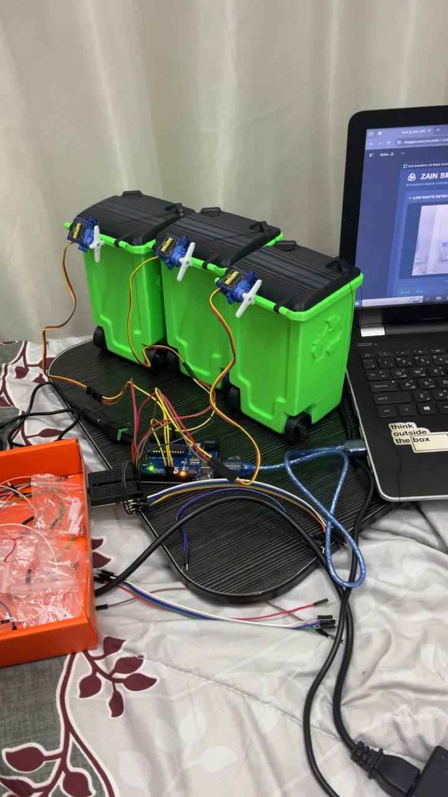

*The finished prototype: dedicated 3D-printed bins for paper, plastic, and metal.*

[**Watch the Demo**](assets/videos/DEMO.MOV) · [**Project Documentation**](docs/Project_Document.pdf)  · [**Source Code**](smartsort_app.py)

</div>

---

## ✨ Project at a Glance

**ZAIN SMARTSORT** is a client-commissioned educational smart waste-sorting prototype developed for a school science-fair demonstration. I worked on this project as a **freelance software and hardware developer**, creating and integrating the Python application, pretrained AI image classifier, Arduino control, electronic connections, and the physical bin-opening system. The completed project was **delivered to the client**. It is **not a personal university assignment**.

A laptop webcam captures an object. The Python application uses a pretrained image-classification model to determine whether it belongs to **paper, plastic, or metal**. The application highlights the selected destination and sends a command to an **Arduino UNO**. The Arduino moves the corresponding **SG90 servo motor**, opening the lid of the correct **3D-printed bin** for a short time before closing it.

> **What is automated?** The **identification, bin selection, and lid movement**. The person still places the object inside the open bin. This is an educational prototype, not a fully autonomous industrial waste sorter.

### Project details

| | |
|---|---|
| **Type** | Paid/commissioned freelance client project; educational working prototype |
| **Developed by** | **Rama Al-Najjar** — technical development and system integration |
| **Educational demonstration** | STS FAIR 2026 |
| **Student participant / presenter** | Zain Yaser Al-Najjar |
| **Location / year** | Jordan · 2026 |
| **Supported bins** | Paper · Plastic · Metal |
| **AI model** | Pretrained [`tribber93/my-trash-classification`](https://huggingface.co/tribber93/my-trash-classification) |
| **Controller** | Arduino UNO R3, USB serial communication at 9600 baud |
| **Lid mechanism** | Three SG90 micro servos, one per 3D-printed bin |

### Key capabilities

- Live webcam preview in a custom desktop interface.
- AI-assisted classification into **PAPER**, **PLASTIC**, or **METAL**.
- Visual indication of the detected material and selected bin, with a per-prediction model score.
- Python-to-Arduino communication over a USB serial port.
- Physical opening and closing of the corresponding bin lid.
- Hardware connection / AI model status indicators.
- Software-only testing when Arduino is disconnected (no physical lid movement).

---

## 📷 1. The Prototype — From Construction to Final Result

All photographs below are actual project documentation. The three bins were **3D printed** and fitted with servo-operated lids.

### 1.1 Completed prototype

<div align="center">
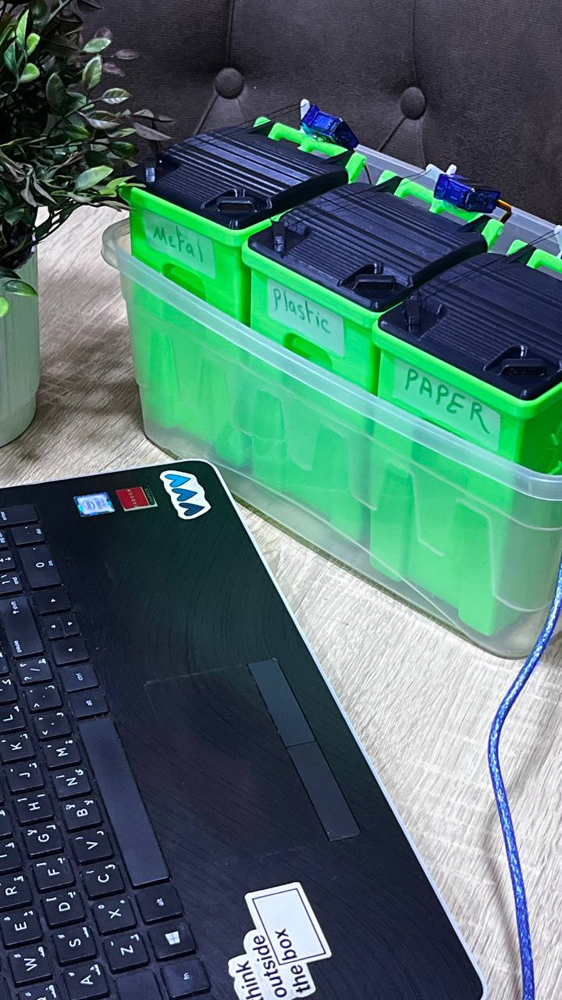

*Final arrangement of the three labeled, 3D-printed waste bins.*
</div>

### 1.2 Hardware components and early testing

| Preparing the components | Early component test |
|:---:|:---:|
| 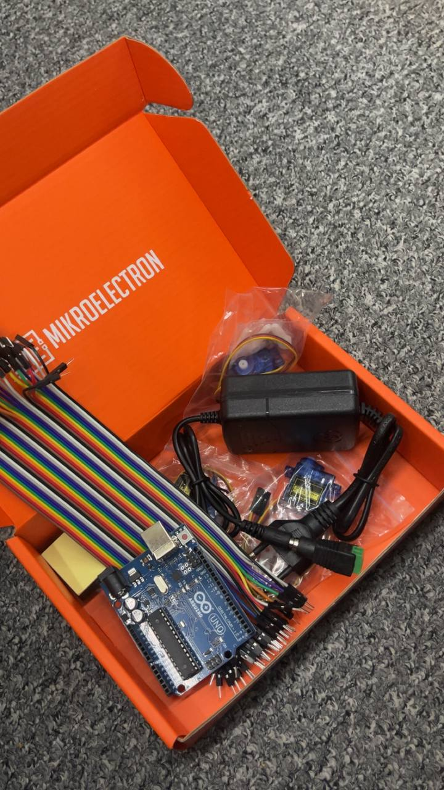 | 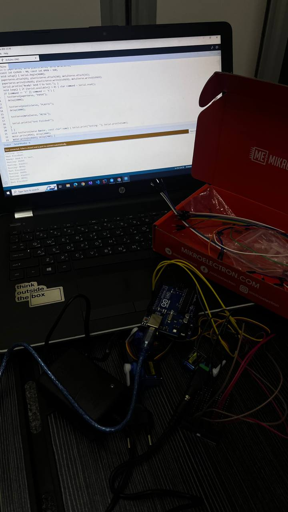 |
| **Components:** Arduino UNO, three SG90 servo motors, wiring, power adapter and assembly materials. | **Preparation and testing:** checking the electronics and control workflow before final integration. |

### 1.3 Building the electronics and wiring

| Assembly and connections | Completed electrical connections |
|:---:|:---:|
|  | 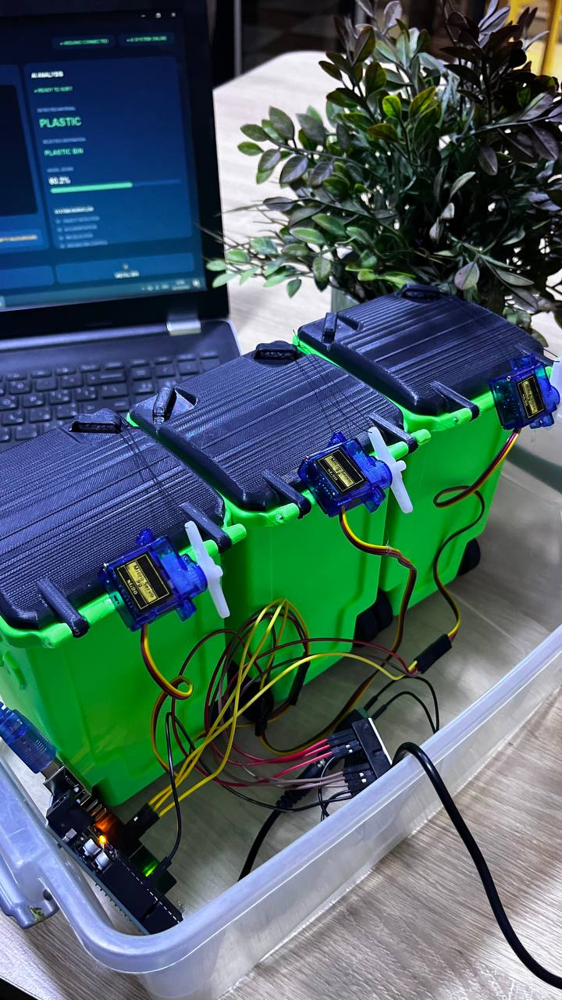 |
| Connecting the bins, servos, and control system. | Final connections used to operate the three lids. |

### 1.4 Desktop application — running interface

<div align="center">
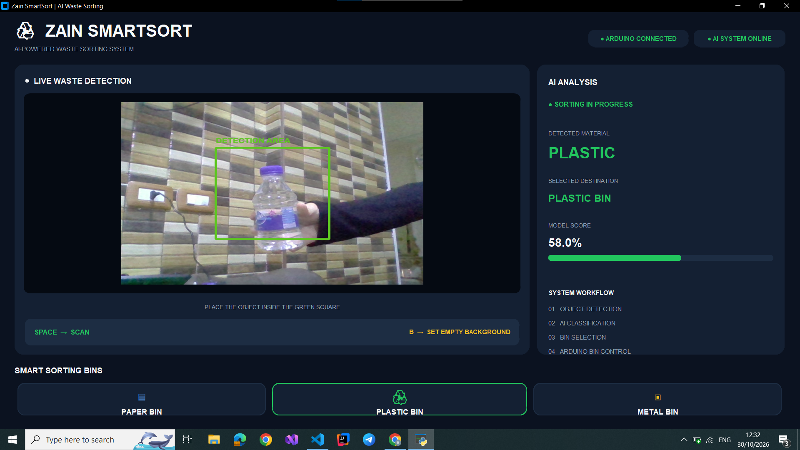

*The desktop application displays the live camera view, detection information, selected material/bin, model score, and connection indicators.*
</div>

When an item is classified, the application highlights the corresponding **PAPER**, **PLASTIC**, or **METAL** destination. If Arduino is ready, it also sends the matching instruction to open the correct physical lid.

### 1.5 Real-world material tests

| Metal | Paper | Plastic |
|:---:|:---:|:---:|
| 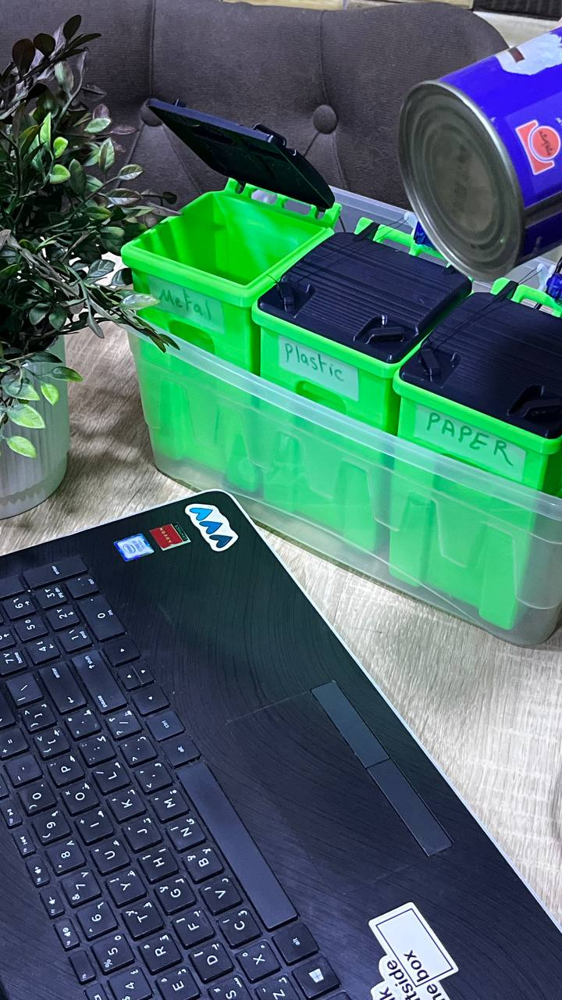 | 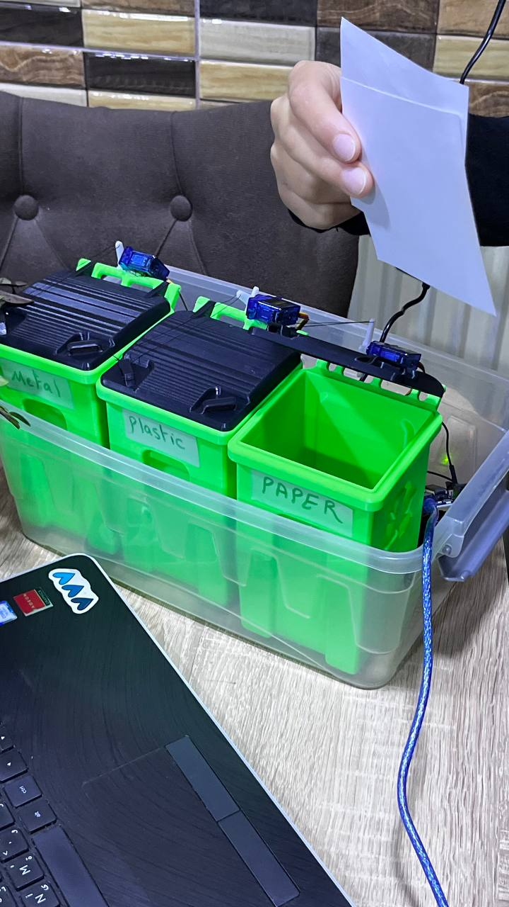 | 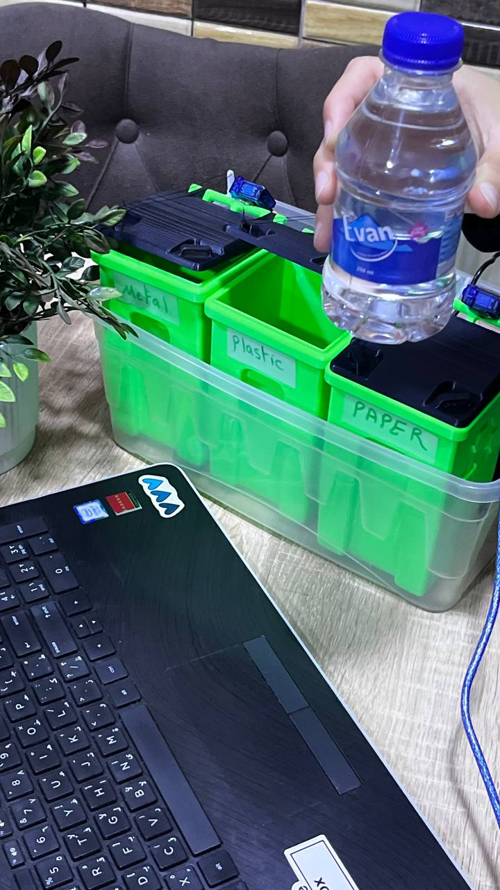 |
| **METAL** — the metal lid opens. | **PAPER** — the paper lid opens. | **PLASTIC** — the plastic lid opens. |

The images document working demonstrations; they do not establish a measured overall AI accuracy rate.

---

## 🎬 2. Working Demo & Project Documents

### Watch the completed system

<div align="center">
<a href="assets/videos/DEMO.MOV"></a>

**▶️ [WATCH THE FULL PROJECT DEMONSTRATION](assets/videos/DEMO.MOV)**

*Click the screenshot or link to open the actual recorded demonstration (`assets/videos/DEMO.MOV`).*
</div>

The demo shows the interaction between the camera-based application, selected waste category, Arduino, and the physical lid mechanism.

> **Video compatibility:** GitHub does not guarantee inline playback of `.MOV` files inside a README. The linked video is included in this repository; depending on the browser, GitHub may open it as a file or offer a download. The preview image above is clickable. No external video hosting or placeholder URL is required.

### 🖼️ Project Poster

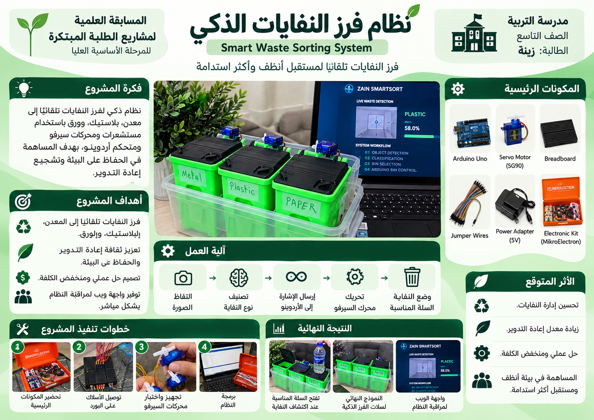

[View the full-size poster](docs/Project_Poster.png)
### Download / view the original documents

| Resource | Open |
|---|---|
| **Full Project Documentation** | 📄 **[Project_Document.pdf](docs/Project_Document.pdf)** |
| **Science Fair Poster** | 🖼️ **[Project_Poster.pdf](docs/Project_Poster.pdf)** |
| **Arduino Firmware** | 💻 **[sketch_oct29a.ino](arduino/sketch_oct29a/sketch_oct29a.ino)** |
| **Python Application** | 🐍 **[smartsort_app.py](smartsort_app.py)** |

These links use the **actual filenames** in this repository, including capitalization and extensions.

---

## 🧠 3. How ZAIN SMARTSORT Works

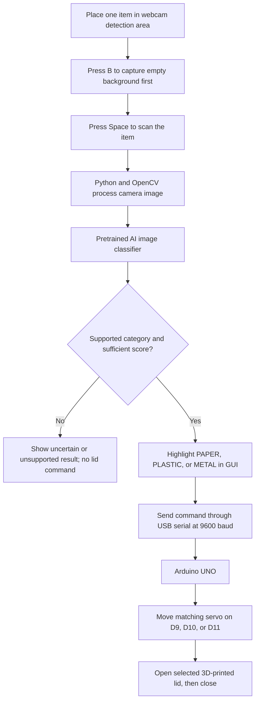

1. **Prepare the view:** Keep the camera still, clear the target area, and press **`B`** to capture the empty background.
2. **Present the item:** Place one sample item in front of the webcam within the detection area.
3. **Request classification:** Press **`Space`**. Python analyzes the captured image using the pretrained classifier.
4. **Choose a destination:** A supported paper, plastic or metal prediction is mapped to the correct bin. The GUI indicates the selected destination.
5. **Send the hardware command:** Python sends `PAPER`, `PLASTIC` or `METAL` to Arduino through its USB serial connection.
6. **Move the lid:** Arduino rotates **only the corresponding servo**; the lid opens briefly, then returns to its closed position.
7. **Dispose of the item:** The user manually places the item inside the opened container.

### Classification-to-hardware mapping

| Classifier result | Destination | Serial command | Arduino pin |
|---|---|---|---|
| `paper` / `cardboard` | Paper bin | `PAPER` | **D9** |
| `plastic` | Plastic bin | `PLASTIC` | **D10** |
| `metal` | Metal bin | `METAL` | **D11** |
| Unsupported / insufficient-confidence result | No destination | No lid-opening command | — |

The application source uses a configurable **minimum classification score of `0.40`**. This is a software threshold—not a measured success rate. The output score for a single image must not be described as overall system accuracy.

### Communication protocol

```text
Python desktop application     Arduino UNO
          |                         |
          |<-------- READY ---------|
          |                         |
          |------ PLASTIC\n ------->|    example request
          |<-------- BUSY ----------|
          |                         |    open plastic lid
          |                         |    hold briefly, then close
          |<-------- DONE ----------|
          |                         |
```

The tested control design uses **9600 baud** and sends one material command at a time. Check the included firmware and Python settings together if adapting the mechanism.

---

## 🧰 4. Components, Tools & Technologies

### Hardware checklist

| Qty. | Component | Why it is needed |
|---:|---|---|
| 1 | **Arduino UNO R3** | Receives commands and produces servo-control signals |
| 3 | **SG90 micro servo motors** | Move the three lids |
| 3 | **3D-printed waste bins with movable lids** | Separate paper, plastic and metal destinations |
| 1 | **Laptop / desktop running Windows** | Runs the AI classifier and graphical interface |
| 1 | **Webcam** (built-in or external) | Captures the waste sample |
| 1 | **USB data cable** compatible with the UNO | Programs the board and carries serial data |
| 1 | **Regulated 5V DC power adapter** (prototype: 2A) | Supplies the servo motors separately |
| 1 | **Female DC barrel adapter / screw-terminal connector** | Connects the regulated adapter to the wiring |
| 1 | **Breadboard or suitable power-distribution connectors** | Distributes servo supply and grounds |
| Several | **Jumper wires** | Connects signal, power, and ground lines |
| As needed | **Servo horns, brackets, mounts and fasteners** | Couples motor movement to each 3D-printed lid |

A servo power supply must be appropriately sized for the real load; **5V/2A describes this prototype**, not a universal guarantee for every servo/lid combination.

### Software stack

| Software | Purpose |
|---|---|
| **Python 3.13** | Runs the desktop application |
| **Visual Studio Code** | Convenient code editor (recommended, not mandatory) |
| **Arduino IDE** | Compiles/uploads the Arduino `.ino` sketch |
| **OpenCV** | Webcam acquisition and image processing |
| **CustomTkinter** | Desktop UI |
| **Transformers + PyTorch** | Loads and executes the pretrained image classifier |
| **NumPy / Pillow** | Image data and image conversion |
| **PySerial** | Communication with Arduino over USB |
| **Git** | Optional method for downloading/updating the project |

**Pretrained model:** [`tribber93/my-trash-classification`](https://huggingface.co/tribber93/my-trash-classification). This project **integrates** the existing model; it does not claim to train or invent it.

---

## 🔌 5. Hardware Wiring — Complete Beginner Guide

### Important safety rules

- **Unplug the servo power adapter and USB cable before touching or changing wiring.**
- **Never connect the servo adapter's positive `+5V` line to the Arduino `5V` pin when the UNO is already powered by USB.** In this build, the external 5V supply powers the servos; the laptop USB powers the Arduino.
- The **external power-supply ground (`−` / GND)** and **Arduino GND** **must be connected together** (common ground).
- Check the marked **`+` / `−` terminals** on the DC adapter; do not assume polarity purely from wire color.
- Do not run three servos from the Arduino's 5V pin. Protect wiring from shorts and avoid forcing a stalled servo or an obstructed lid.

### SG90 wire colors and connections

Each SG90 typically has **three wires**: **yellow/orange** = control signal, **red** = +5V, **brown/black** = ground.

| Bin | Signal wire → Arduino UNO | Red wire → | Brown/black wire → |
|---|---|---|---|
| **PAPER** | **D9** | External supply **+5V** | External supply **GND** |
| **PLASTIC** | **D10** | External supply **+5V** | External supply **GND** |
| **METAL** | **D11** | External supply **+5V** | External supply **GND** |

In addition, connect **one Arduino GND pin** to the **same external GND rail** used by the servo ground wires.

```text
                         WINDOWS LAPTOP
                      Python app + webcam
                             |
                        USB DATA CABLE
                             |
                         ARDUINO UNO
                        ┌──────────────┐
 Paper SG90 signal   <──│ D9           │
 Plastic SG90 signal <──│ D10          │
 Metal SG90 signal   <──│ D11          │
                        │ GND ────────┼───────────┐
                        └──────────────┘           │
                                                   │ (COMMON GROUND)
 REGULATED 5V DC POWER ADAPTER                     │
         +5V ───────────────> ALL 3 SERVO RED WIRES│
         GND ───────────────> ALL 3 SERVO BROWN ───┘

  USB powers Arduino; external regulated 5V powers servos.
  Do not connect external +5V to USB-powered Arduino 5V.
```

### Connect everything in order

1. **Mount the motors:** Attach one SG90 securely near each 3D-printed lid. Connect the appropriate servo horn/linkage so the lid can move freely without hitting a hard stop.
2. **Keep power disconnected:** Put the external power adapter aside until signal, ground, and polarity are checked.
3. **Wire the signal pins:** Paper servo → **D9**; Plastic servo → **D10**; Metal servo → **D11**.
4. **Wire the servo supply:** Connect **all three red wires** to the adapter **+5V** power rail. Connect **all three brown/black wires** to its **GND** rail using the breadboard/secure distribution.
5. **Connect common ground:** Run one jumper from an Arduino **GND** pin to the external **GND** rail. This is necessary even though the Arduino is connected to the laptop by USB.
6. **Double-check polarity and loose wires** before supplying power. Make sure the servo horns have enough physical clearance.
7. **Connect Arduino to the laptop** via USB and upload the `.ino` sketch as described below.
8. Once wiring and firmware are confirmed, **turn on the regulated servo supply**. Run the Python software and make a controlled test using one sample item.

### Actual build photos

| Work-in-progress wiring | Final hardware wiring |
|:---:|:---:|
|  |  |

---

## 💻 6. Run It Yourself — Step by Step (Windows)

You **do not need Microsoft Visual Studio**. Install **Visual Studio Code** to comfortably view/edit code, or run everything from Windows Terminal/Command Prompt.

### Step 1 — Install the programs

1. **Python 3.13:** [python.org/downloads](https://www.python.org/downloads/) — choose Python 3.13; enable **Add Python to PATH** when available.
2. **Visual Studio Code:** [code.visualstudio.com](https://code.visualstudio.com/) — install and add its **Python** extension (recommended).
3. **Arduino IDE:** [arduino.cc/en/software](https://www.arduino.cc/en/software) — use this to upload firmware to the UNO.
4. **Git (optional):** [git-scm.com/downloads/win](https://git-scm.com/downloads/win) — only needed if you want to use `git clone` instead of downloading ZIP.
5. Prepare a working **webcam**, the assembled Arduino/servo hardware, and an **internet connection for the initial AI model download**.

### Step 2 — Get the project files

**Method A — Git:** Open CMD / PowerShell and run:

```powershell
git clone https://github.com/ramaalnajjarr2/ZAIN-SMARTSORT.git
cd ZAIN-SMARTSORT
```

**Method B — no Git:** Open the repository page on GitHub → **Code → Download ZIP** → extract it → open the extracted folder.

### Step 3 — Understand the project structure

```text
ZAIN-SMARTSORT/
├── README.md                         # You are reading this file
├── smartsort_app.py                  # Python application and GUI
├── requirements.txt                  # Python libraries
├── .gitignore                        # Git exclusions
├── arduino/
│   └── sketch_oct29a/
│       └── sketch_oct29a.ino         # Arduino firmware
├── assets/
│   ├── photos/                       # Real build and test images
│   │   ├── finalbin.jpg
│   │   ├── PreTools.jpg
│   │   ├── check1.jpg
│   │   ├── connection.jpg
│   │   ├── FinalConnection.jpg
│   │   ├── RUNPAGE.png
│   │   ├── metaltest.jpg
│   │   ├── papertest.jpg
│   │   └── plastictest.jpg
│   └── videos/
│       └── DEMO.MOV                  # Real project demonstration
└── docs/
    ├── Project_Document.pdf          # Full project document
    └── Project_Poster.pdf            # Science fair poster
```

The folder names and filename capitalization in this diagram match the files committed for this project.

### Step 4 — Create a Python virtual environment

Open the project folder in **VS Code → File → Open Folder**, then **Terminal → New Terminal**. Alternatively, open Command Prompt directly in that folder.

Check Python:

```powershell
py -3.13 --version
```

Create the environment:

```powershell
py -3.13 -m venv .venv
```

You do **not** need to activate the environment. All commands below call its Python interpreter directly, avoiding PowerShell execution-policy problems.

### Step 5 — Install Python dependencies

In the project folder, run:

```powershell
.\.venv\Scripts\python.exe -m pip install --upgrade pip
.\.venv\Scripts\python.exe -m pip install -r requirements.txt
```

This installs the libraries from [`requirements.txt`](requirements.txt): `opencv-python`, `customtkinter`, `numpy`, `Pillow`, `transformers`, `torch`, and `pyserial`.

> **First-time setup:** `torch` and the pretrained model can involve large downloads. Package versions are not currently pinned; future compatibility may require choosing tested versions if upstream packages change.

### Step 6 — Program your Arduino UNO

1. Connect the **Arduino UNO** to the laptop using a **USB data cable**.
2. Launch **Arduino IDE**.
3. Open [`arduino/sketch_oct29a/sketch_oct29a.ino`](arduino/sketch_oct29a/sketch_oct29a.ino).
4. Choose **Tools → Board → Arduino AVR Boards → Arduino Uno**.
5. Choose **Tools → Port → COMx**, selecting the port assigned to your UNO.
6. Press **Verify** (checkmark) and then **Upload** (arrow). Wait for **Done uploading**.
7. **Close Arduino Serial Monitor and Serial Plotter** before running Python. Two applications usually cannot access the same COM port simultaneously.
8. Ensure the three motors have the correct **external regulated 5V supply** and **shared ground**, then turn on servo power.

The Arduino firmware uses the standard Arduino **Servo** library (`Servo.h`). It should process the `PAPER`, `PLASTIC`, and `METAL` commands at **9600 baud** and open the corresponding lid. The actual open/closed angles depend on the installed horn and hinge orientation; do not force a different mechanical assembly to use untested angles.

### Step 7 — Check the serial port in Python

Open [`smartsort_app.py`](smartsort_app.py) and locate these settings near the beginning:

```python
MODEL_NAME = "tribber93/my-trash-classification"
MIN_CONFIDENCE = 0.40
SERIAL_PORT = "COM4"      # Example from the original setup
SERIAL_BAUD = 9600
```

**`COM4` is not the correct port on every computer.** To find yours:

1. Connect Arduino using USB.
2. Open **Windows Device Manager → Ports (COM & LPT)**, or check **Arduino IDE → Tools → Port**.
3. Read the actual Arduino port (for example `COM3` or `COM5`).
4. Replace `"COM4"` with that port, **save** `smartsort_app.py`, and close Arduino Serial Monitor.

### Step 8 — Start the Python app

From the project folder, run:

```powershell
.\.venv\Scripts\python.exe smartsort_app.py
```

On the first launch, the application may download the pretrained model from Hugging Face. Wait until the AI is initialized and the camera interface is ready.

**What you should see:** A desktop application headed **ZAIN SMARTSORT**, a live camera preview, classification/bin indicators, and AI/Arduino connection status. Compare with the real screenshot:

<div align="center">

</div>

### Step 9 — Complete your first waste-sorting test

1. Put the camera in a steady position and make sure the green detection area is **empty**.
2. Press **`B`** to capture the clean background.
3. Place **one paper, plastic or metal item** in the detection area.
4. Press **`Space`** to classify it.
5. Watch the detected material and the highlighted destination in the GUI.
6. If Arduino is connected and the classification is accepted, the selected lid opens briefly and then closes.
7. Manually place the item into the correct bin while the lid is open.
8. Remove the item. Repeat for the next sample, capturing the background again with `B` if the camera or lighting changes.

| Keyboard control | Action |
|---|---|
| **`B`** | Capture an empty-background reference |
| **`Space`** | Start classification/scanning |
| **`Esc`** | Close the application |

### Step 10 — Can I test without hardware?

**Yes, for software testing.** You can launch the camera and AI application even if Arduino is disconnected. The hardware status will show disconnected/offline, and **no bin lid will open**. This is useful for checking the camera, AI prediction, and interface before wiring the electronics.

### Step 11 — Shut down safely

Close the Python application, disconnect the regulated **servo power**, and unplug the Arduino USB cable before moving or changing the circuit.

---

## 🧪 7. Testing & Interpretation

The working prototype was demonstrated with paper, plastic and metal objects, using both on-screen results and physical bin-opening tests.

| Test | What to confirm | Evidence |
|---|---|---|
| Paper object | Paper is selected and paper lid opens/closes | [Paper test photo](assets/photos/papertest.jpg) |
| Plastic object | Plastic is selected and plastic lid opens/closes | [Plastic test photo](assets/photos/plastictest.jpg) |
| Metal object | Metal is selected and metal lid opens/closes | [Metal test photo](assets/photos/metaltest.jpg) |
| Hardware connection | Correct Arduino COM port and serial command exchange | [Arduino firmware](arduino/sketch_oct29a/sketch_oct29a.ino) |
| End-to-end operation | Camera → classifier → GUI → Arduino → lid | [Demo video](assets/videos/DEMO.MOV) |

**Important:** A prediction score displayed by the model (such as 58% or 64.7% for an individual sample) is **not an experimentally measured accuracy figure**. A trustworthy accuracy claim needs many labeled trials, recorded expected/predicted results, and separate tracking of successful motor operations. No unverified test counts or accuracy rates are claimed here.

---

## 🛠️ 8. Troubleshooting

| Symptom | What to do |
|---|---|
| `Arduino not connected` / cannot open `COM4` | Check USB **data** cable; find the correct COM port; update `SERIAL_PORT`; close Arduino Serial Monitor and other programs using the port. |
| Arduino uploads but a lid does not move | Verify D9/D10/D11 signals, shared GND, 5V external servo supply, servo linkage, and correct firmware. |
| Wrong lid opens | Check the `PAPER` / `PLASTIC` / `METAL` signal-to-pin mapping and whether motors are attached to the correct physical bin. |
| Servo buzzes or stalls | **Disconnect power**; check lid friction, servo angles, motor mounting, and power adequacy. Do not force the mechanism. |
| Python says a module is missing | Run the exact `pip install -r requirements.txt` command using `.venv` from Step 5. |
| AI model fails to load | Check internet on the first run, model availability, installed package compatibility, and terminal messages. |
| Webcam is black or unavailable | Grant Windows camera permissions, close video-call apps, verify camera connection. |
| Nothing happens after pressing Space | Wait for AI initialization, set empty background with `B`, then press `Space` with an object in view. |
| Classifier chooses the wrong material | Keep one sample in frame, use consistent lighting, reduce background clutter, and recapture empty background. |
| Arduino upload fails | Check board/port selection; close Python and Serial Monitor; reconnect UNO by USB and retry. |
| Photos or PDFs do not show on GitHub | Ensure all filenames/extensions/capitalization match these relative paths and the files were pushed to `main`. |
| Demo video link downloads instead of playing | This can happen with `.MOV` on GitHub; open the downloaded clip in a compatible media player. |

---

## 📁 9. Project Files & Technical Notes

- [`smartsort_app.py`](smartsort_app.py) — camera handling, pretrained AI classification, GUI, classification display, serial communication and application controls.
- [`arduino/sketch_oct29a/sketch_oct29a.ino`](arduino/sketch_oct29a/sketch_oct29a.ino) — Arduino UNO firmware controlling the three motors.
- [`requirements.txt`](requirements.txt) — Python packages required by the app.
- [`assets/photos/`](assets/photos/) — original build, wiring, UI and test photographs.
- [`assets/videos/DEMO.MOV`](assets/videos/DEMO.MOV) — real working prototype video.
- [`docs/Project_Document.pdf`](docs/Project_Document.pdf) — full documentation.
- [`docs/Project_Poster.pdf`](docs/Project_Poster.pdf) — presentation poster.

### Technical limitations

- Three categories only: paper, plastic and metal; not every material is supported.
- The AI runs on the **laptop**, not on the Arduino UNO.
- Camera lighting, background, and object appearance can affect classification.
- The physical servo action depends on correctly powered motors and compatible lid mechanics.
- The lid opens automatically, but the object is **placed into the bin by a person**.
- This repository documents a **working educational client prototype**, not an industrial-grade commercial waste-management product.

### Possible future enhancements

- Evaluate a wider range of objects and fine-tune a model on a carefully labeled dataset.
- Add glass/organic-waste categories using additional bins and validated predictions.
- Log repeated classification outcomes and motor success rates.
- Improve 3D-printed hinges, mounts, enclosure, and power-distribution robustness.
- Add fill-level sensors or a standalone embedded computing platform.

These are future ideas, **not features already implemented**.

---

## 👩‍💻 10. Freelance Development & Credits

### Built and delivered as a freelance client project

**I am Rama Al-Najjar, a software engineering developer in Jordan.** I developed and delivered ZAIN SMARTSORT as a **commissioned freelance project** for a client who needed a complete, demonstrable educational solution. The work brought together **Python, AI model integration, a custom GUI, Arduino firmware/communication, electronic wiring, testing, and 3D-printed mechanical components**. The repository shows both the finished result and the technical process behind it.

The prototype was presented in an educational science-fair context by **Zain Yaser Al-Najjar**. Technical development and the student's presentation role are credited separately.

### Interested in a custom project?

I welcome inquiries about **freelance software projects, Python applications, Arduino prototypes, AI-powered demos, automation, and software–hardware integration**.

**[Contact me via my GitHub profile](https://github.com/ramaalnajjarr2)** to discuss a project or collaboration.

### Acknowledgments

- **AI model:** [`tribber93/my-trash-classification`](https://huggingface.co/tribber93/my-trash-classification) — pretrained by its original publisher and integrated here; it was **not trained from scratch** in this project.
- **Open-source ecosystem:** Arduino, OpenCV, CustomTkinter, PyTorch, Hugging Face Transformers, PySerial and other library maintainers.
- **Educational context:** STS FAIR 2026, with student participation/presentation credited as described above.

---

<div align="center">

**ZAIN SMARTSORT · Freelance Software & Hardware Project · Jordan · 2026**

*Turning a live AI prediction into a real-world physical action.*

</div>
