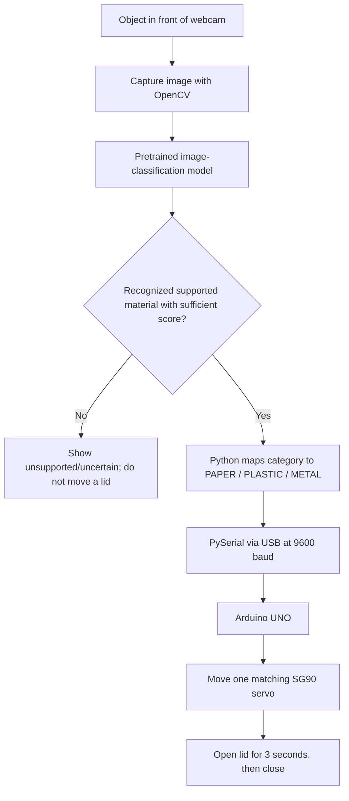

# ♻️ ZAIN SMARTSORT

### AI-Powered Smart Waste Sorting System | Python · Computer Vision · Arduino UNO

**Project type:** Client-requested educational prototype · Software & hardware integration · Jordan (2026)  
**Technical development and integration:** Rama Al-Najjar  
**School science-fair participant/presenter:** Zain Yaser Al-Najjar  
**Project context:** STS FAIR 2026 school science-fair demonstration

> **Project context and ownership:** ZAIN SMARTSORT was developed as a **client-requested educational prototype**, in a freelance-style project arrangement, to support a school science-fair demonstration. It is **not presented here as a personal university assignment**. Technical development and integration are credited separately from the student participant's educational presentation. This description does **not** claim a completed sale or payment. Any public credit must accurately reflect contributions and follow the science fair's participation rules.

<!-- ============================================================
IMAGE 01 — MAIN HERO / FINAL PROTOTYPE
Use the user's ORIGINAL photo showing all three GREEN bins together
from the FRONT (Metal / Plastic / Paper). Ideally choose the clear photo
with the three labels visible and without a person covering the bins.
Save as: assets/photos/final_prototype.jpg
When the file exists, delete the comment marks around the next line:

============================================================ -->

**Demo:** [Watch the working prototype](https://example.com/REPLACE-WITH-YOUR-DEMO-VIDEO) *(replace this placeholder after uploading the video)*  
**Full documentation:** [Project Report (PDF)](docs/Project_Report.pdf) *(add the finished PDF at this path)*  
**Science-fair poster:** [Project Poster (PDF)](docs/Project_Poster.pdf) *(add the finished PDF at this path)*

---

## 1. Project Overview

ZAIN SMARTSORT is a working prototype of a camera-assisted waste-sorting system. The user holds an item in front of a laptop webcam, sets a clean background, and initiates a scan. A **pretrained image-classification model** predicts the item category, and a custom Python desktop application maps that prediction to one of three supported bins: **PAPER, PLASTIC, or METAL**. The application then sends a command over USB serial to an **Arduino UNO**, which controls **three SG90 servo motors** mounted on the bins. The matching lid opens briefly and closes automatically.

This project demonstrates a complete **software-to-hardware workflow**: computer vision → AI inference → Python application → serial communication → physical actuation. It also shows how a small educational prototype can illustrate useful ideas in recycling and waste management.

**Important scope:** The system opens the suitable lid; **the user manually puts the waste into the bin**. This is a prototype, **not a commercial automatic sorter** and not an AI model able to recognize every possible waste item.

### Why build it?

Waste is often disposed of without separating paper, plastic, and metal. This project explores how an accessible camera, a pretrained AI model, and inexpensive electronic components can assist users in selecting the right container and encourage sorting at the source.

### What I developed

- Integrated a third-party pretrained vision model into a Python application.
- Built the live camera interface and on-demand classification workflow.
- Added a clear result display, destination selection, model score, and Arduino connection indicator.
- Implemented USB serial communication with readiness and completion messages.
- Integrated three separately controlled servo-driven bin lids.
- Tested the camera, classifier, serial communication, motor motion, and combined prototype.

**AI attribution:** The baseline model, [`tribber93/my-trash-classification`](https://huggingface.co/tribber93/my-trash-classification), was **pretrained by its publisher**. It was integrated into this application; it was **not trained from scratch** as part of this build.

---

## 2. Photos — From Components to the Finished Prototype

The photos below are intended to be **original documentation photographs**. Use your own images; no AI-generated or reconstructed photos are necessary.

### 2.1 The completed bins

<!-- PHOTO 02 — FRONT VIEW
Choose the clear original image of three closed green bins, showing the labels
"Metal", "Plastic", "Paper" on the front. Different angle from the hero is OK.
Save as: assets/photos/bins_front.jpg
Enable below when the file exists:

-->

### 2.2 Rear wiring and the controller

Three SG90 servo motors are mounted near the bin lids. Their signal wires run to three digital pins on the Arduino UNO; the servo power comes from a separate regulated 5V supply. All components must share the correct ground reference for the control signals to work.

<!-- PHOTO 03 — REAR WIRING / COMPLETED ELECTRONICS
Use the clear photo taken BEHIND the bins with the blue SG90 servo bodies,
Arduino UNO, jumper wires, and breadboard visible.
Save as: assets/photos/bins_back.jpg
Enable below when the file exists:

-->

### 2.3 Building and testing

| Stage | What the image should show | Filename to use |
|---|---|---|
| 01 — Preparing components | Original photo of the **orange electronics box** containing Arduino, jumpers, SG90 servos and 5V adapter | `assets/photos/components.jpg` |
| 02 — Breadboard and power connections | Close-up of the **black mini breadboard** with red/brown wires | `assets/photos/breadboard_wiring.jpg` |
| 03 — Servo preparation | Close-up of **three blue SG90 motors with white arms/horns** | `assets/photos/servo_testing.jpg` |
| 04 — Arduino code | Original photo of **Arduino IDE showing the test sketch** | `assets/photos/arduino_programming.jpg` |
| 05 — Serial test | Original photo showing **Testing: PAPER / PLASTIC / METAL / Test finished!** | `assets/photos/serial_test.jpg` |
| 06 — Assembly | All **three bins with installed servo motors**, before final tidying | `assets/photos/assembly.jpg` |

<!-- PHOTO 04 — COMPONENTS: orange kit box, Arduino, motor packaging

-->
<!-- PHOTO 05 — BREADBOARD: red/brown wires connected to black mini breadboard

-->
<!-- PHOTO 06 — SERVO: three blue motors held in hand, white arms visible

-->
<!-- PHOTO 07 — PROGRAMMING: laptop displaying Arduino IDE sketch

-->
<!-- PHOTO 08 — SERIAL TEST: screen shows PAPER / PLASTIC / METAL and Test finished!

-->
<!-- PHOTO 09 — ASSEMBLY: three bins with servo wiring visible

-->

> **Photo checklist:** Keep the captions short. You can add the original files later and remove each `<!-- ... -->` comment around its matching Markdown image line. Do not upload several copies of the same shot under different names.

---

## 3. Final Result — Real Application and Working Bins

### 3.1 Desktop application

The Python interface shows a live camera feed, the green detection region, the predicted material, the corresponding bin, a **model score**, and connection indicators for Arduino and AI loading.

<!-- SCREENSHOT 01 — METAL: use the REAL full-screen screenshot from this chat
The app detects METAL, shows METAL BIN and a 64.7% model score.
Save as: assets/screenshots/metal_detection.png

-->

<!-- SCREENSHOT 02 — PLASTIC: use the REAL full-screen screenshot from this chat
The app detects a plastic bottle, shows PLASTIC BIN and 58.0% model score.
Save as: assets/screenshots/plastic_detection.png

-->

> **Model score ≠ overall accuracy.** The on-screen percentage belongs to a single AI prediction; it must not be reported as the percentage of successful tests over all samples.

### 3.2 Physical bin-opening tests

<!-- PHOTO 10 — METAL: ORIGINAL photo of a metal can above the open Metal bin
Save as: assets/photos/metal_test.jpg

-->
<!-- PHOTO 11 — PAPER: ORIGINAL photo with a sheet of paper and the Paper lid open
Save as: assets/photos/paper_test.jpg

-->
<!-- PHOTO 12 — PLASTIC: ORIGINAL photo with a water bottle and open Plastic bin
Save as: assets/photos/plastic_test.jpg

-->

### 3.3 Watch the final demonstration

<!-- VIDEO — upload your own VIDEO, not a generated video.
Recommended: 30–90 seconds, showing (1) physical prototype, (2) webcam scan,
(3) model prediction/destination, (4) the right lid opening and closing.
Optional second video: time-lapse/behind-the-scenes assembly and wiring.
YouTube unlisted or a direct shareable LinkedIn video link both work.
Replace the placeholder URL below with the ACTUAL public/unlisted video URL.
For a thumbnail, save a real video still as assets/screenshots/demo_thumbnail.jpg
and enable this line:
[](https://example.com/REPLACE-WITH-YOUR-DEMO-VIDEO)
-->

**▶ [Watch the ZAIN SMARTSORT working demo](https://example.com/REPLACE-WITH-YOUR-DEMO-VIDEO)** *(replace with the actual video URL)*

**Behind the scenes:** `PASTE_BEHIND_THE_SCENES_VIDEO_URL_HERE` *(optional)*

### 3.4 Documentation

- [Full Scientific Project Report](docs/Project_Report.pdf) — project context, hypothesis, background, materials, procedure, tests, findings, conclusion and references.
- [Science Fair Poster](docs/Project_Poster.pdf) — visual summary for the fair.
- [Test results](docs/TEST_RESULTS.md) — repeatable test records; only fill with actual observations.

**Before publishing:** Put these files at exactly the paths linked above, or edit the links to the filenames you really use. GitHub links to nonexistent files will not work.

---

## 4. System Architecture



**Mapping in the Python code:**

| AI model output | Bin selected | Arduino command | Signal pin |
|---|---|---|---|
| `paper`, `cardboard` | Paper | `PAPER` | D9 |
| `plastic` | Plastic | `PLASTIC` | D10 |
| `metal` | Metal | `METAL` | D11 |
| `glass`, `trash`, unsupported/uncertain result | None | No command | — |

The app uses a minimum classification-score threshold of **0.40** by default. This is a **software decision threshold**, not a measured accuracy rate. The implementation maps the supported labels to the three available bins; some other labels are rejected instead of forcing a bin selection.

The Arduino uses a simple serial protocol:

```text
Arduino -> Python: READY       (initialization complete)
Python  -> Arduino: PLASTIC\n  (example: one command followed by newline)
Arduino -> Python: BUSY        (motor action started)
Arduino -> Python: DONE        (lid cycle completed)
```

This prevents sending overlapping bin-opening actions. Only **one bin** is commanded to open at a time, although all three servos remain powered when the power supply is on.

---

## 5. Hardware and Software Used

### Hardware

| Quantity | Component | Purpose |
|---:|---|---|
| 1 | Arduino UNO R3 | Receives serial commands and drives servo signals |
| 3 | SG90 micro servo motors | Opens and closes the three lids |
| 3 | Mini waste bins with movable lids | Paper, plastic and metal destinations |
| 1 | Windows laptop with a webcam | Runs the GUI and image classifier |
| 1 | USB data cable | Powers/programs the Arduino and carries serial messages |
| 1 | Regulated **5V DC, 2A** adapter used in the prototype | Separate power supply for the servos |
| 1 | Female DC barrel connector with `+` and `−` terminals | Connects the 5V DC adapter to power wiring |
| 1 | 170-point mini breadboard | Wiring distribution / prototyping |
| Several | Jumper wires | Servo signal, power and shared-ground connections |
| 1 | Supporting container/mounts/servo horns | Mechanical assembly |

**Note:** This records the prototype configuration; a 5V/2A supply is not guaranteed to be adequate for heavier lids or multiple stalled servos. Use appropriately rated wiring and power components for any upgraded build.

### Software

| Tool | What it does |
|---|---|
| Python 3.13 (development setup: 3.13.7) | Desktop application logic |
| Visual Studio Code | Source-code editor (optional; not required at runtime) |
| Arduino IDE 2.x | Compiles/uploads the UNO sketch |
| OpenCV (`opencv-python`) | Webcam access and image/frame processing |
| NumPy | Image data operations |
| Pillow (`PIL`) | Image conversion for the classifier/GUI |
| CustomTkinter | Desktop interface |
| Hugging Face Transformers + PyTorch | Pretrained AI model loading/inference |
| PySerial | USB serial communication with Arduino |

Libraries are listed in [`requirements.txt`](requirements.txt). External runtime libraries such as `threading`, `queue`, and `time` are part of Python's standard library and are not listed separately.

---

## 6. Circuit Wiring — Arduino UNO + 3 SG90 Servos

### Pin assignments

| Bin | SG90 yellow/orange signal | SG90 red power | SG90 brown/black ground |
|---|---|---|---|
| Paper | Arduino **D9** | External regulated **+5V** | External supply **GND** |
| Plastic | Arduino **D10** | External regulated **+5V** | External supply **GND** |
| Metal | Arduino **D11** | External regulated **+5V** | External supply **GND** |

Also connect **Arduino GND ↔ external supply GND** (common ground). Connect the Arduino to the laptop with a **USB data cable**. All three servo red wires connect to the external regulated 5V supply via a suitable power-distribution connection; all brown wires connect to its ground. Do **not** power all three servos from the Arduino 5V pin.

```text
                  Laptop / Windows
                 Python GUI + AI Model
                          |
                    USB data cable
                          |
                      Arduino UNO
                D9 -------- PAPER servo signal (yellow)
                D10 ------- PLASTIC servo signal (yellow)
                D11 ------- METAL servo signal (yellow)
                GND -------------------------+
                                             |
5V DC adapter  (+) -----> servo RED wires    |
               (-) -----> servo BROWN wires -+
```

**Safety:**

- **Turn off the external adapter and disconnect USB before changing the wiring.**
- The adapter's `+` and `−` must be checked by label/polarity before connection; never guess polarity from wire color alone.
- Keep USB-powered Arduino **5V** separate from the servo adapter **+5V**. The common-ground link is intentional.
- Use securely clamped/appropriate power distribution; don't leave loose jumper pins exposed or short the power rails.
- The SG90 needs enough clearance and a properly fixed mounting point. Avoid forcing its horn against a mechanical stop.
- The prototype drives **one servo operation at a time**; it does not eliminate transient current spikes or stall risks.

<!-- PHOTO 13 — CIRCUIT CLOSEUP
Use the original breadboard photo or a sharp, real view of the assembled
wiring showing how all three servo signals go to D9/D10/D11.
Save as: assets/photos/wiring_closeup.jpg

-->

---

## 7. Reproduce the Project on a Windows Computer — Full Guide

> These steps assume the software is available locally and the hardware has already been assembled and checked. The original setup used Windows and an Arduino UNO. **You do not need Microsoft Visual Studio**: **Visual Studio Code** is sufficient as an editor, and you can run the app from a terminal without any editor.

### Step 1 — Install the necessary programs

1. **Python 3.13** — download from https://www.python.org/downloads/ and, if offered, check **Add Python to PATH** during setup.
2. **Visual Studio Code** (recommended editor) — https://code.visualstudio.com/ ; install the official Python extension in VS Code.
3. **Arduino IDE 2.x** — https://www.arduino.cc/en/software ; it is used to open and upload `.ino` code to the Arduino UNO.
4. **Git** (optional, for cloning and updating the repository) — https://git-scm.com/downloads/win . You can instead use **Code → Download ZIP** from GitHub.
5. A **working webcam**, an Arduino UNO, a USB data cable, the three properly powered/connected SG90 motors, and internet access at least for the model's first download.

### Step 2 — Download the project

Option A: use Git in CMD/PowerShell:

```powershell
git clone https://github.com/ramaalnajjar2/ZAIN-SMARTSORT.git
cd ZAIN-SMARTSORT
```

Option B: on GitHub choose **Code → Download ZIP**, extract the archive, then open the extracted project folder.

Expected project structure:

```text
SmartSort/
├── smartsort_app.py
├── requirements.txt
├── .gitignore
├── README.md
├── arduino/
│   └── sketch_oct29a/
│       └── sketch_oct29a.ino
├── assets/
│   ├── screenshots/
│   ├── photos/
│   └── videos/
└── docs/
    ├── Project_Report.pdf
    ├── Project_Poster.pdf
    └── TEST_RESULTS.md
```

**Arduino filename rule:** Arduino IDE expects the folder and its `.ino` sketch to have matching names. This repository structure assumes the final tested sketch is `arduino/sketch_oct29a/sketch_oct29a.ino`. If the real sketch uses another name, update this path accordingly and keep the folder/file names matched.

### Step 3 — Open the folder and Terminal

- Open **VS Code → File → Open Folder... → SmartSort**.
- Open **Terminal → New Terminal** inside VS Code, or open CMD/PowerShell directly in the project folder.
- Check your interpreter:

```powershell
py -3.13 --version
```

### Step 4 — Create the virtual environment

```powershell
py -3.13 -m venv .venv
```

You **do not need to activate** `.venv` in PowerShell. Running its Python executable directly avoids the common `Activate.ps1` execution-policy prompt.

### Step 5 — Install all Python libraries

```powershell
.\.venv\Scripts\python.exe -m pip install --upgrade pip
.\.venv\Scripts\python.exe -m pip install -r requirements.txt
```

The dependency download (especially `torch`) may be substantial. The supplied `requirements.txt` lists package names without exact version pins; this was deliberately kept flexible, but future reproducible releases should record the **versions actually tested together**.

### Step 6 — Upload the Arduino program

1. Disconnect the external servo supply before adjusting wiring; verify all pins and polarity.
2. Connect the UNO to the laptop over USB.
3. In **Arduino IDE**, open the **tested final `.ino` file** from the `arduino/` directory.
4. Select **Tools → Board → Arduino AVR Boards → Arduino Uno** (exact menu naming may vary).
5. Select **Tools → Port → COMx** corresponding to the connected Arduino (the original development machine used `COM4`).
6. Click **Verify** and then **Upload**. Wait for **Done uploading**.
7. Close the Arduino **Serial Monitor** and Serial Plotter before starting Python, because only one program can normally own the COM port at a time.
8. With the verified servo wiring and correct power distribution in place, power the servo supply and run the integrated application.

> **Firmware contract:** Python expects the Arduino firmware to print `READY` after startup, accept a newline-terminated `PAPER`, `PLASTIC`, or `METAL` command at **9600 baud**, print `BUSY` when opening a lid, and print `DONE` when the lid has closed. Use the **actually tested final Arduino sketch**. A generic reference firmware is not automatically interchangeable with servo mounting angles on the real prototype.

### Step 7 — Check app settings

Open [`smartsort_app.py`](smartsort_app.py) and verify this configuration near the beginning:

```python
MODEL_NAME = "tribber93/my-trash-classification"
MIN_CONFIDENCE = 0.40
SERIAL_PORT = "COM4"    # Change to the port actually shown on your PC
SERIAL_BAUD = 9600
```

How to find `COMx`: open **Windows Device Manager → Ports (COM & LPT)** while Arduino is connected, or look at **Tools → Port** in Arduino IDE. Set the matching port in `smartsort_app.py`. `COM4` is **not universal**; it was the original development setting.

### Step 8 — Run the Python desktop application

From the VS Code Terminal / PowerShell in the project folder:

```powershell
.\.venv\Scripts\python.exe smartsort_app.py
```

Or in CMD:

```cmd
.venv\Scripts\python.exe smartsort_app.py
```

Wait for the model to load. On the **first run**, the pretrained model may download from Hugging Face over the internet and take additional time. The app then displays a live camera feed and status indicators.

### Step 9 — Use the GUI and perform a sorting test

1. Place the camera so an object can be shown inside the **green detection area**.
2. Remove any object from the area, keep the camera still, then press **`B`** to set the *empty background*.
3. Place a **single paper, plastic or metal item** in the green area.
4. Press **`Space`** to start a scan.
5. Check **Detected Material**, **Selected Destination**, **Model Score**, and the Arduino connection indicator.
6. If the item is recognized with sufficient confidence and Arduino is connected, the corresponding lid opens for about **3 seconds** and then closes (per the reference Arduino settings).
7. Wait for the previous lid action to finish before scanning another item.
8. If you move the camera or change the background significantly, remove the object and press **`B`** again before scanning.

| Shortcut | Function |
|---|---|
| `B` | Save the empty camera background |
| `Space` | Scan the current object |

### Step 10 — Test without an Arduino

The app can also be started **without hardware connected**. It will show **Arduino not connected / offline**, while still allowing model/camera testing once the AI model is ready and an empty background has been set. **No servo moves in this mode.** This is useful for debugging the classifier independently of the physical bins.

### Step 11 — Shut down

- Stop scanning and close the Python application.
- Disconnect the regulated servo power supply when finished.
- Unplug USB if you need to modify or move the electronics.

---

## 8. Testing and Evaluation

The prototype was tested using physical paper, plastic and metal samples and by observing the serial output and lid movement. To evaluate it rigorously, record **two separate outcomes** in every trial:

1. **Correct classification:** did the AI choose the right category?
2. **Successful lid operation:** did the app select the correct destination and did the appropriate lid **open and close**? (The user still places the item in the bin.)

| Material | Trials | Correct AI classifications | Correct lid operations |
|---|---:|---:|---:|
| Paper | To be recorded | To be recorded | To be recorded |
| Plastic | To be recorded | To be recorded | To be recorded |
| Metal | To be recorded | To be recorded | To be recorded |

**Classification accuracy** = correct classifications ÷ total trials × 100%.  
**End-to-end sorting success** = trials where both classification and corresponding lid operation were correct ÷ total trials × 100%.

Do **not** replace these values with the model score shown for one particular object. To report a reliability result, test a repeatable set of samples under documented conditions (including lighting and camera distance).

**Suggested test record:** [`docs/TEST_RESULTS.md`](docs/TEST_RESULTS.md) — record material, sample description, expected result, predicted result, model score, lid motion, lighting, and notes.

---

## 9. Troubleshooting

| Problem | Checks / fix |
|---|---|
| `Could not open port COM4` / `Arduino not connected` | Plug in Arduino using a USB **data** cable, identify the actual COM port, change `SERIAL_PORT`, and close Serial Monitor. The app should still support software-only classification. |
| Arduino connects but no lid opens | Confirm the Arduino sketch implements `READY` / `BUSY` / `DONE`, the correct D9/D10/D11 signal mapping, the separate regulated 5V supply, and shared GND. |
| `programmer is out of sync` / upload fails | Close Python and Serial Monitor, disconnect interfering devices if needed, verify UNO board and correct port, then retry with the USB cable alone when appropriate. |
| `No READY response from Arduino` | Check firmware sends `READY` after startup at 9600 baud and that no other app owns the port; opening serial can reset the UNO. |
| GUI starts but nothing scans | Wait for `AI SYSTEM ONLINE`, clear the detection region, press `B`, place one object, then press `Space`. |
| `AI MODEL ERROR` or import failure | Confirm internet connection for initial download, install `requirements.txt`, and review the terminal traceback. |
| Camera not working | Allow Windows camera permissions, close other camera apps, check the webcam connection/device. |
| Inaccurate material prediction | Use steady lighting, reduce clutter, show one object at a time, recapture the background, and collect additional evaluation samples. |
| Servo buzzes, stalls, or struggles | Disconnect power; inspect the bracket, hinge, lid weight, horn position, correct angles and power capacity. Never force a stalled servo. |
| PowerShell script `untrusted publisher` / execution-policy prompt | You don't need to run `Activate.ps1`; use `.\.venv\Scripts\python.exe` directly as shown above. |
| Video or image not visible in README | Ensure the exact relative path matches the file name, extension and capitalization committed to GitHub. |

---

## 10. Challenges and Engineering Lessons

This project required more than getting a model prediction on screen:

- **Hardware integration:** connecting and safely powering three small servo motors with a shared ground and separate regulated supply.
- **Serial protocol:** handling UNO reconnects, initial `READY` handshake, and `BUSY` / `DONE` messages so motor commands are not mixed.
- **UI responsiveness:** keeping camera/model processing and serial communication from freezing the desktop interface.
- **Mechanical constraints:** selecting servo horns and angles and securely mounting each motor to a lightweight bin lid.
- **AI reliability:** separating *one prediction's model score* from measured classification accuracy, and acknowledging unknown/unsupported categories.
- **Reproducibility:** packaging code, dependencies, firmware, build photos, demo video and tested operating instructions into a public repository.

---

## 11. Current Limitations

- Only three physical destinations: paper, plastic and metal; other materials may be unsupported or misclassified.
- Detection reliability depends on the pretrained model and environmental conditions (background, lighting, camera angle, item shape).
- A laptop and camera are required in this version; classification is **not performed on the Arduino UNO**.
- The bin opening is automatic; placing the item inside remains manual.
- Servo size, lid weight and power capacity limit what can be moved safely.
- A model score in the GUI must not be interpreted as an independently measured dataset accuracy.

## 12. Future Improvements

- Collect a more diverse, clearly labeled waste-image dataset, and **fine-tune** or compare classification models.
- Add support for glass, organic waste and other useful categories after testing.
- Add a dedicated `UNKNOWN`/reject option with more systematic confidence calibration.
- Log repeated classification and servo test outcomes, and chart class-by-class accuracy.
- Improve mechanics/mounts, power distribution and electrical enclosure for longer operation.
- Add fill-level sensors and an indication when a bin needs emptying.
- Explore running classification on suitable small embedded hardware, removing the need for a laptop.

These are **proposed future enhancements**, not existing features of the released prototype.

---

## 13. Credits and Attribution

**Technical developer:** **Rama Al-Najjar** — Python GUI, AI model integration, Arduino communication, servo/hardware integration, troubleshooting and technical documentation, as applicable to the actual work performed.

**School science-fair participant/presenter:** **Zain Yaser Al-Najjar**, presenting the educational application and demonstrating the prototype at **STS FAIR 2026**.

**Pretrained model:** [`tribber93/my-trash-classification`](https://huggingface.co/tribber93/my-trash-classification) on Hugging Face. The model is credited to its original publisher; this repository does not claim to have created or originally trained it.

**Third-party tools:** Arduino, OpenCV, CustomTkinter, Hugging Face Transformers, PyTorch, PySerial and related dependencies remain credited to their respective authors.

**Transparency:** The prototype was developed in a client-requested/freelance-style educational context. Describing the project this way does not imply a particular payment, formal contract or sale. Credit both the development work and the student's learning/presentation role accurately and check any applicable science-fair originality rules.

---

## 14. Useful References

- [Pretrained AI model used](https://huggingface.co/tribber93/my-trash-classification)
- [Arduino documentation](https://docs.arduino.cc/)
- [Arduino IDE downloads](https://www.arduino.cc/en/software)
- [Python downloads](https://www.python.org/downloads/)
- [Visual Studio Code downloads](https://code.visualstudio.com/)
- [OpenCV documentation](https://docs.opencv.org/)
- [Hugging Face Transformers documentation](https://huggingface.co/docs/transformers)
- [PySerial documentation](https://pyserial.readthedocs.io/)

## 15. License

No license is included yet. Please decide whether the custom code is intended to be publicly reusable before adding a license. Check the model's and dependency libraries' licenses separately. Publicly visible code is not automatically licensed for unrestricted reuse.

---

### ✅ Before pushing to GitHub — publication checklist

- [ ] `smartsort_app.py` is the **final working Python source**.
- [ ] `arduino/sketch_oct29a/sketch_oct29a.ino` is the **actual tested final Arduino sketch** (or update the paths here).
- [ ] `requirements.txt` was tested in a fresh `.venv`.
- [ ] `.gitignore` prevents uploading `.venv`, downloaded models and private files.
- [ ] All image comments above have been replaced with Markdown image lines **after** the named real files were added.
- [ ] Replace the demo-link placeholder `https://example.com/REPLACE-WITH-YOUR-DEMO-VIDEO` with the actual video URL, or remove it until available.
- [ ] Add the final report and poster PDFs under `docs/` or correct their links.
- [ ] Add actual test data if reporting performance metrics.
- [ ] Confirm credit/attribution and science-fair submission rules.
- [ ] Confirm there are no exposed passwords, identifiable private screens, or other confidential material in screenshots/video.

**Project status:** Working educational prototype · Documentation and multimedia links are added as available.
